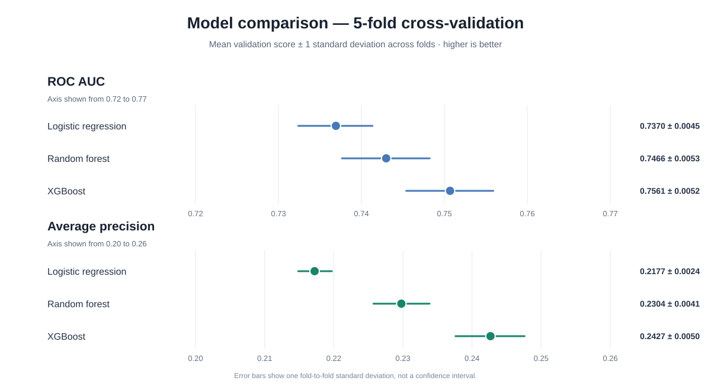
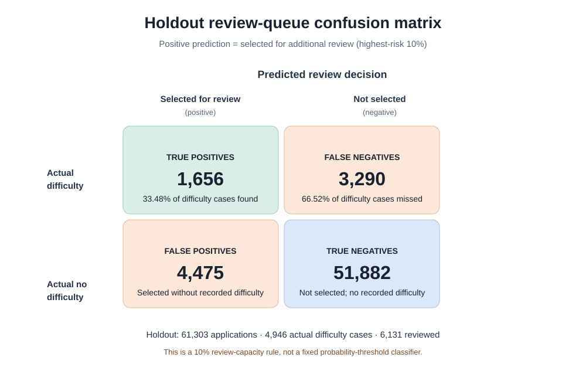
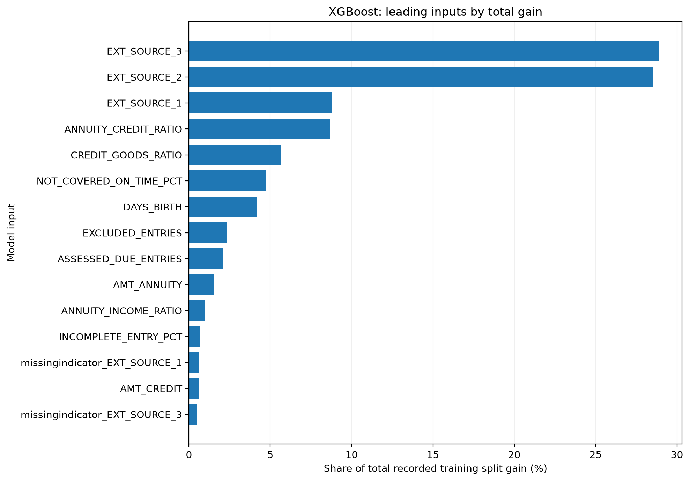
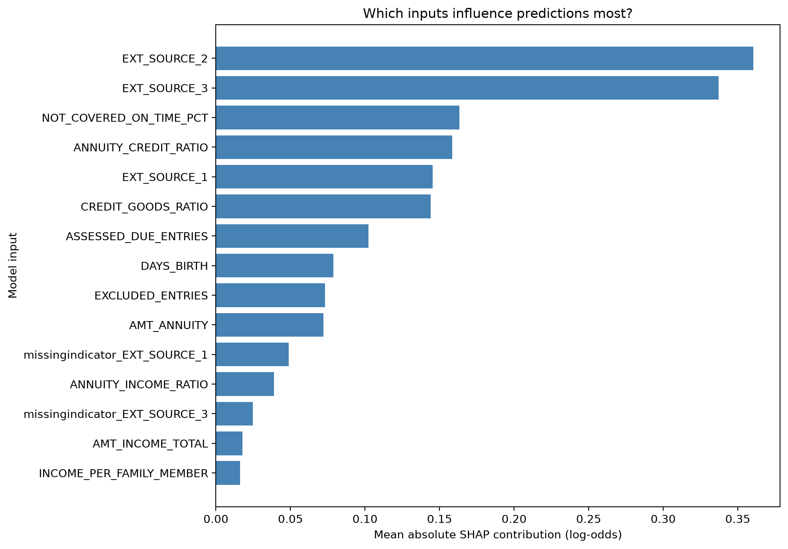
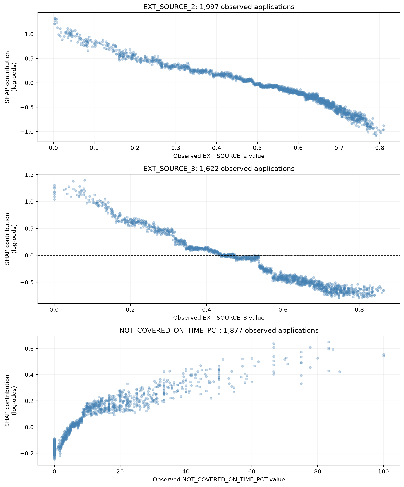
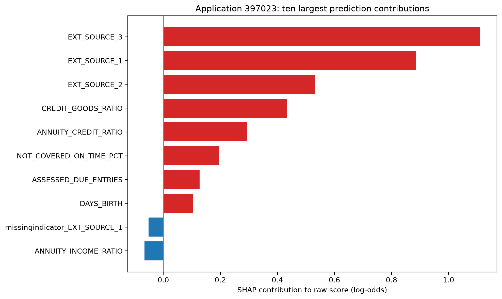

# Home Credit Default Risk

Exploratory analysis and machine learning to predict payment difficulty,
with repayment-history feature engineering and a simulated review queue.

## Objective

Estimate payment difficulty for current Home Credit applications and
evaluate whether ranking applications by predicted risk can help
prioritize additional review.

The outcome is the dataset's TARGET label. The project does not measure
the effect of an intervention or implement an automatic lending decision.

## Dataset

Source: [Home Credit Default Risk — Kaggle](https://www.kaggle.com/competitions/home-credit-default-risk/data)

The labelled application table contains 307,511 applications.

### Data used in this version

| Source | Use |
|---|---|
| application_train.csv | Application features, target, development and holdout partitions |
| installments_payments.csv | Engineered repayment-history features |
| previous_application.csv | Exploratory analysis and early feature experiments |
| bureau.csv | Exploratory analysis of external credit records |

The selected final model uses application and instalment-history inputs.

Monthly bureau, POS/cash, and credit-card histories are potential
extensions. Competition test predictions and a Kaggle submission have
not been produced in this version.

Raw datasets are obtained separately from Kaggle.

## Approach

1. Explore application, previous-application, and credit-history data.
2. Define conservative rules for assessing recorded instalment repayments.
3. Engineer application ratios and applicant-level repayment summaries.
4. Compare feature sets and classification algorithms.
5. Evaluate the selected model on a reserved holdout.
6. Examine review prioritization, group-level calibration, and SHAP explanations.

### Selected inputs

The final model uses 16 original inputs:

- Four basic application inputs.
- Three external scores.
- Five application ratios.
- Four repayment-history inputs.

Missing numeric inputs are imputed using training-data medians.
Missingness indicators are added where applicable.

## Validation

- Development applications: 246,208.
- Holdout applications: 61,303.
- Model comparison: five-fold stratified cross-validation on development data.
- Preprocessing is fitted within each training fold.

### Development cross-validation results

| Model | Mean ROC AUC ± SD | Mean average precision ± SD |
|---|---:|---:|
| Logistic regression | 0.7370 ± 0.0045 | 0.2177 ± 0.0024 |
| Random forest | 0.7466 ± 0.0053 | 0.2304 ± 0.0041 |
| XGBoost | **0.7561 ± 0.0052** | **0.2427 ± 0.0050** |

*Error bars show one standard deviation across the five validation folds;
they are not confidence intervals.*

XGBoost was selected using development results.

Full holdout metrics are available in
[holdout_results.csv](reports/holdout_results.csv).

### Holdout ROC and Precision–Recall curves

The notebook now includes a reproducible plotting section that calculates
the ROC curve and Precision–Recall curve from the selected XGBoost model's
per-application holdout probabilities. Run the final **Holdout validation
curves and review-queue matrix** section in
[the modelling notebook](notebooks/home_credit_analysis_and_modeling.ipynb)
after the holdout prediction cell has run.

That section saves:

- `figures/holdout_roc_curve.png`
- `figures/holdout_precision_recall_curve.png`
- `figures/holdout_review_confusion_matrix.png`
- `reports/holdout_prediction_scores.csv`

The ROC and Precision–Recall images are generated by the notebook when
rerun; they are not embedded here until those actual holdout-score-based
files have been added to the repository. This avoids presenting
illustrative or fabricated curves as measured model results.

### Holdout review-queue confusion matrix

The following matrix uses the project's operating rule: select the
highest-risk 10% of holdout applications for additional review. A
positive prediction therefore means **selected for review**, not a
probability threshold of 0.50.

The policy selected 6,131 applications and identified 1,656 of the
4,946 applications with recorded payment difficulty. It left 3,290
difficulty cases outside the review group. See
[holdout_results.csv](reports/holdout_results.csv) for the complete
holdout summary.

## Simulated review queue

Applications were ranked by predicted risk. The highest-risk 10% were
selected for additional review.

| Measure | Holdout result |
|---|---:|
| Applications selected | 6,131 |
| Difficulty cases identified | 1,656 |
| False positives | 4,475 |
| Difficulty cases outside the selected group | 3,290 |
| Precision | 27.01% |
| Recall | 33.48% |
| Lift relative to overall difficulty rate | 3.35 |

Approximately 27% of selected applications had recorded difficulty,
compared with approximately 8% across the holdout.

These results describe historical selection performance. They do not
demonstrate financial savings or improved repayment outcomes.

## Visualizations and model interpretation

The figures below provide complementary views of the fitted model:
training-time feature importance, global and feature-level SHAP patterns,
and an explanation of one individual prediction.

### 1. Training gain-based feature importance

*Gain-based importance summarises how much each feature contributes to
improvements from the model's tree splits. It does not show whether a
feature raises or lowers an individual prediction.*

### 2. Global SHAP importance

*Global SHAP importance ranks features by their average absolute
contribution to model predictions across the explanation sample.*

In the explanation sample, EXT_SOURCE_2 and EXT_SOURCE_3 had the largest
mean absolute SHAP contributions. Repayment timeliness and loan ratios
also contributed substantially. NOT_COVERED_ON_TIME_PCT was the leading
repayment-history input.

### 3. SHAP dependence plots

*Dependence plots show how observed feature values relate to their SHAP
contributions. They help inspect the direction, shape, and possible
non-linear patterns of the model's learned relationships.*

### 4. Individual SHAP explanation

*The individual explanation decomposes one prediction into feature-level
contributions relative to the model's baseline, showing which inputs
push that prediction higher or lower.*

SHAP and gain-based importance describe model behaviour, not causal
effects. These explanations should support analysis and review, not be
treated as reasons for an automatic lending decision.

## Project files

| Location | Contents |
|---|---|
| notebooks/ | Analysis and modelling notebook, plus repayment feature helper |
| reports/ | Model comparisons, holdout metrics, calibration and feature summaries |
| figures/ | Exported explanation charts |
| requirements.txt | Versions of the principal Python dependencies |

## Running the project

1. Download the original data from Kaggle.
2. Install the dependencies listed in requirements.txt.
3. Open notebooks/home_credit_analysis_and_modeling.ipynb in Jupyter.
4. Update the notebook's data paths for your computer.
5. Keep home_credit_repayment_features.py beside the notebook.
6. Run the notebook in order.

The repayment feature builder uses temporary disk storage. Processing
the complete repayment table can take time.

## Limitations

- Random historical validation does not establish future performance.
- Recorded histories can be incomplete or require exclusion.
- No assessable history does not imply perfect repayment.
- Correlated inputs can share or substitute for one another's contributions.
- Group-average calibration does not guarantee individual probability accuracy.
- Additional data sources may improve performance but require controlled testing.
- The model has not been validated for live lending decisions.

## Tools

Python, pandas, NumPy, scikit-learn, XGBoost, Matplotlib, Jupyter,
SQLite, and joblib.
